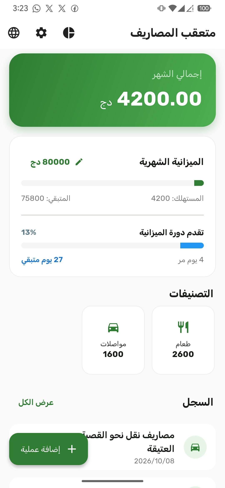
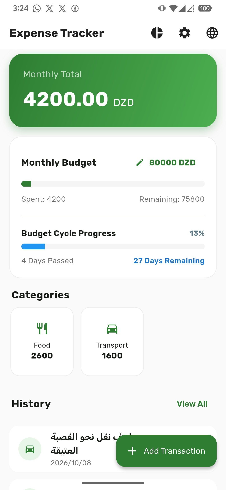

<div align="center">

# 💰 Expense Tracker

**A private, high-performance, local-first personal finance manager built with Flutter.**

[](https://flutter.dev/)
[](https://dart.dev/)
[](https://www.sqlite.org/)
[](https://opensource.org/licenses/MIT)
[](https://github.com/billelaggab/expense-tracker/pulls)

<p align="center">
  <a href="#-key-features">Key Features</a> •
  <a href="#-screenshots">Screenshots</a> •
  <a href="#-tech-stack">Tech Stack</a> •
  <a href="#-project-structure">Project Structure</a> •
  <a href="#-getting-started">Getting Started</a> •
  <a href="#-contributing">Contributing</a>
</p>

</div>

---

## 📖 Overview

**Expense Tracker** is designed with a strict **Local-First** philosophy. Your financial data is sensitive, and it belongs solely to you. There are no external analytics, cloud tracking, or mandatory accounts. All transactions, budgets, and settings reside securely in an offline SQLite database on your device, providing instantaneous launch speeds, smooth animations, and complete data sovereignty.

Built from the ground up to support both **Arabic** (RTL) and **English** (LTR) natively, the app delivers a tailored, culturally aligned user experience with seamless on-the-fly language switching.

---

## ✨ Key Features

- 🔒 **100% Local-First & Zero Telemetry**  
  Zero remote servers or third-party trackers. All records are stored locally using SQLite (`sqflite`), guaranteeing total privacy and offline availability.

- 🌍 **Bilingual & RTL-Native (Arabic & English)**  
  Instant runtime switching between Arabic and English with full Right-to-Left (RTL) and Left-to-Right (LTR) layout adaptability.

- 📊 **Interactive Analytics & Categorization**  
  Rich graphical breakdowns powered by `fl_chart`. Inspect monthly spending by category, track trends, and identify cash flow patterns at a glance.

- 🎯 **Dynamic Budget Management**  
  Define custom monthly spending caps. Visual progress indicators provide immediate feedback on remaining funds and consumption velocity.

- ⏱️ **Intelligent Budget Cycle Tracking**  
  Track your custom billing cycle with a synchronized progress timeline showing days elapsed versus remaining in your budget period.

- 💾 **Portable JSON Backup & Restore**  
  Export full backups in human-readable JSON format, share via system sheets (`share_plus`), and restore anytime without friction.

- 🎨 **Modern Material 3 Aesthetic**  
  Clean, accessible UI built around Material Design 3 guidelines, paired with bundled local `Rubik` typography for consistent rendering across platforms.

---

## 📱 Screenshots

<div align="center">
  <table>
    <tr>
      <td align="center" width="20%">
        <b>Dashboard</b><br/><br/>
        
      </td>
      <td align="center" width="20%">
        <b>Add Expense</b><br/><br/>
        
      </td>
      <td align="center" width="20%">
        <b>Transactions History</b><br/><br/>
        
      </td>
      <td align="center" width="20%">
        <b>Analytics & Stats</b><br/><br/>
        
      </td>
      <td align="center" width="20%">
        <b>Settings & Backup</b><br/><br/>
        
      </td>
    </tr>
  </table>
</div>

---

## 🛠️ Tech Stack

| Layer | Technology | Purpose |
| :--- | :--- | :--- |
| **Framework** | [Flutter](https://flutter.dev/) (Dart SDK `^3.0.0`) | Cross-platform UI toolkit |
| **Local Database** | [`sqflite`](https://pub.dev/packages/sqflite) & [`path`](https://pub.dev/packages/path) | High-performance relational persistence |
| **Preferences** | [`shared_preferences`](https://pub.dev/packages/shared_preferences) | Key-value store for app configuration and active budget parameters |
| **Data Visualization** | [`fl_chart`](https://pub.dev/packages/fl_chart) | Interactive charts and category breakdown graphs |
| **Internationalization** | [`intl`](https://pub.dev/packages/intl) & Custom Localization | Multilingual locale handling and number/currency formatting |
| **File I/O & Sharing** | [`file_picker`](https://pub.dev/packages/file_picker), [`share_plus`](https://pub.dev/packages/share_plus), [`path_provider`](https://pub.dev/packages/path_provider) | JSON file creation, picker dialogues, and system share intents |
| **Design System** | Material 3 & [Rubik Font](https://fonts.google.com/specimen/Rubik) | Responsive typography and modern component styles |

---

## 📂 Project Structure

```text
expense_tracker/
├── assets/
│   └── fonts/                 # Bundled offline fonts (Rubik Regular, SemiBold, Bold)
├── lib/
│   ├── models/                # Domain models (Transaction, Category definitions)
│   │   └── transaction.dart
│   ├── screens/               # Presentation layer and application screens
│   │   ├── home_dashboard.dart           # Primary dashboard & budget overview
│   │   ├── add_transaction_screen.dart   # Transaction creation and editing
│   │   ├── transactions_list_screen.dart # Chronological transaction log
│   │   ├── stats_screen.dart             # Charts, analytics, and category breakdown
│   │   └── settings_screen.dart          # Currency, language, and backup controls
│   ├── services/              # Core business logic & persistence
│   │   ├── database_service.dart         # SQLite queries and migrations
│   │   ├── localization_service.dart     # AR/EN translations and locale state
│   │   └── backup_service.dart           # JSON export, import, and validation
│   ├── theme/                 # Design tokens, color schemes, and component themes
│   │   └── app_theme.dart
│   └── main.dart              # Application bootstrap & dependency setup
├── UI/
│   └── Screenshots/           # Visual documentation assets
└── pubspec.yaml               # Project dependencies and asset manifests
```

---

## 🚀 Getting Started

### Prerequisites

Ensure you have the following installed in your local development environment:

- **[Flutter SDK](https://docs.flutter.dev/get-started/install)** (`>= 3.0.0 < 4.0.0`)
- **[Dart SDK](https://dart.dev/get-dart)** (bundled with Flutter)
- An Android device / iOS simulator / Android Emulator

Verify your installation with:

```bash
flutter doctor
```

### Installation

1. **Clone the repository:**
   ```bash
   git clone https://github.com/billelaggab/expense-tracker.git
   cd expense-tracker
   ```

2. **Fetch dependencies:**
   ```bash
   flutter pub get
   ```

3. **Run the application:**
   ```bash
   # Run in debug mode on connected device
   flutter run
   ```

4. **Build release packages (Optional):**
   ```bash
   # Android APK
   flutter build apk --release

   # Android App Bundle (AAB)
   flutter build appbundle --release
   ```

---

## 🗺️ Roadmap

- [ ] 🔐 **Biometric Authentication** (Fingerprint / Face ID unlock)
- [ ] 💱 **Multi-Currency Support** with manual conversion rates
- [ ] 🔄 **Recurring Transactions** (Subscriptions & recurring bills)
- [ ] 🏷️ **Custom Category Tags & Color Pickers**
- [ ] 📄 **PDF / CSV Report Generation**

---

## 🤝 Contributing

Contributions, feedback, and feature requests are welcome!

1. **Fork** the repository
2. Create your feature branch (`git checkout -b feature/amazing-feature`)
3. Commit your changes (`git commit -m 'feat: add amazing feature'`)
4. Push to the branch (`git push origin feature/amazing-feature`)
5. Open a **Pull Request**

---

## 📄 License

This project is licensed under the **MIT License**. See the [LICENSE.md](LICENSE.md) file for details.

---

<div align="center">

Crafted with care by **[Billel Aggab](https://github.com/billelaggab)** • Empowering financial mindfulness with complete privacy.

</div>
